

  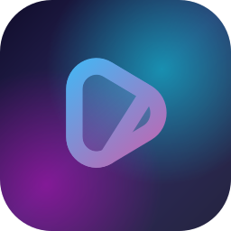

<h1 align="center">Viaura</h1>

  <b>A fast, modern, liquid-glass Android media player & hub — local video, music, online streaming and plugins in one app.</b>
   
  <i>Powered by the mpv engine. Built with Kotlin & Jetpack Compose. No Play Store needed — grab the APK from Releases.</i>

  
  

  
  
  
  
  
  

> [!IMPORTANT]
> Join the community on Telegram: **[t.me/god_kartik_viaura](https://t.me/god_kartik_viaura)**

---

## Table of Contents

- [Showcase](#showcase)
- [What is Viaura?](#what-is-viaura)
- [Feature Overview](#feature-overview)
- [Detailed Features](#detailed-features)
- [Installation](#installation)
- [Updating](#updating)
- [Building from Source](#building-from-source)
- [Tech Stack & Credits](#tech-stack--credits)
- [Disclaimer](#disclaimer)
- [Support the Project](#support-the-project)

---

## Showcase

<i>Real screenshots from the app. Every image is stripped of metadata.</i>

### 📁 Video Library

  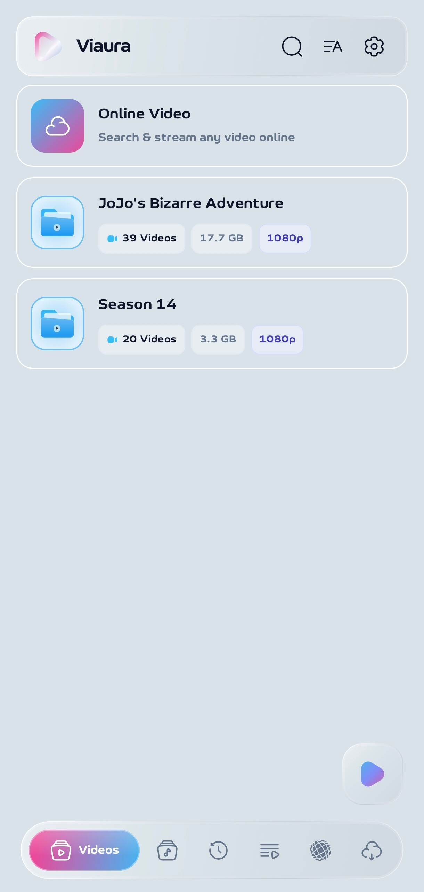
  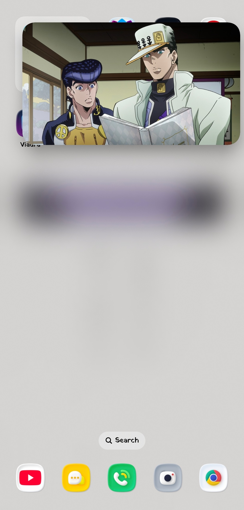

> **Left:** the **Videos** home screen. Every folder is a glass card showing the number of videos, total size and detected resolution (for example *39 Videos · 17.7 GB · 1080p*). The **Online Video** card at the top lets you search and stream videos from the internet. The floating dock at the bottom switches between Videos, Music, Recents, Playlists, Network and Downloads.
> **Right:** **Picture-in-Picture** — keep watching in a floating window while you use other apps.

### 🎬 Video Player

  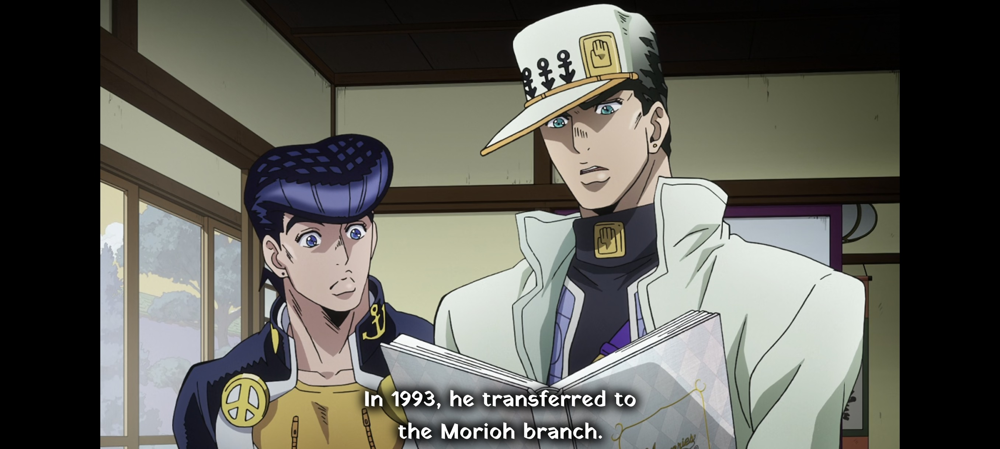
  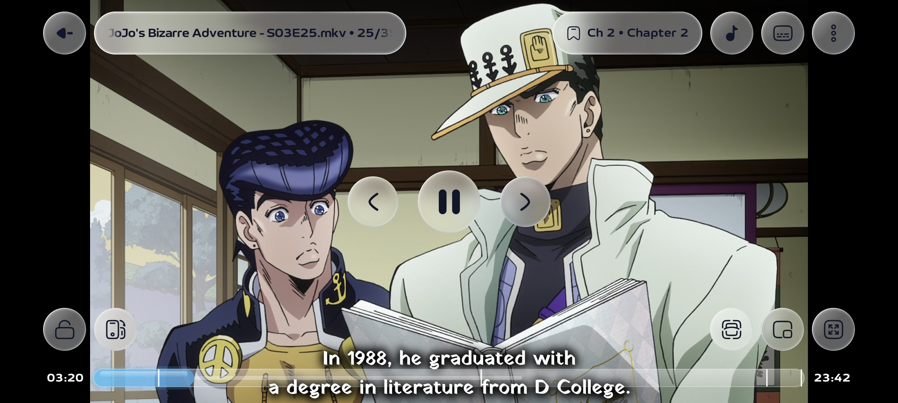

> **Left:** the landscape player powered by **libmpv** with **libass** — styled ASS/SSA subtitles with outline and shadow on a 1080p video.
> **Right:** the control overlay — title and episode counter, chapters, audio-only mode, subtitle and audio panels, lock, rotation, zoom, picture-in-picture, and a glass seek bar with current / total time.

  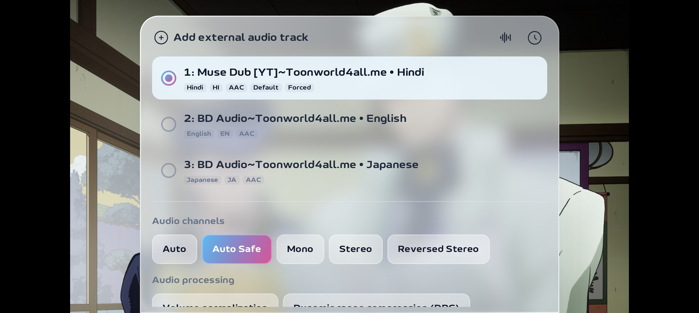
  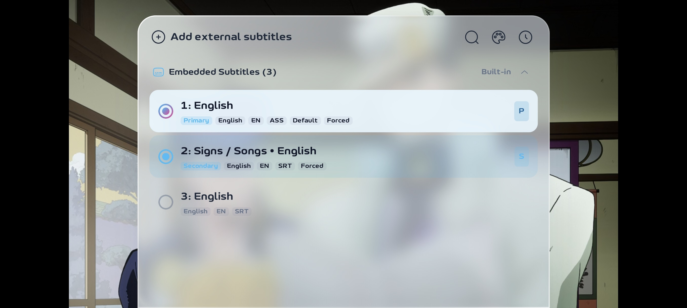
  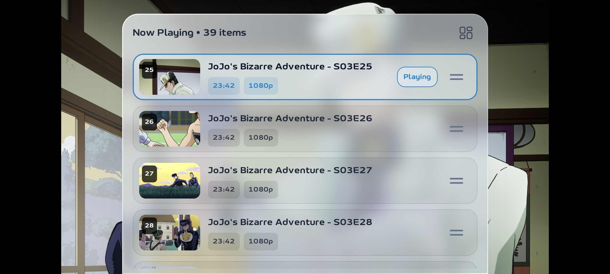

> **Audio panel** — switch between embedded audio tracks (language, codec, default / forced tags), add an external audio track, and pick channel modes (Auto, Auto Safe, Mono, Stereo, Reversed Stereo) plus audio processing.
> **Subtitle panel** — embedded tracks with format badges (ASS, SRT), **primary** and **secondary** subtitles at the same time, search, style editor and delay.
> **Playlist panel** — all episodes with thumbnails, duration and resolution; the playing one is highlighted and the list can be reordered.

### 🎵 Music Player & Lyrics

  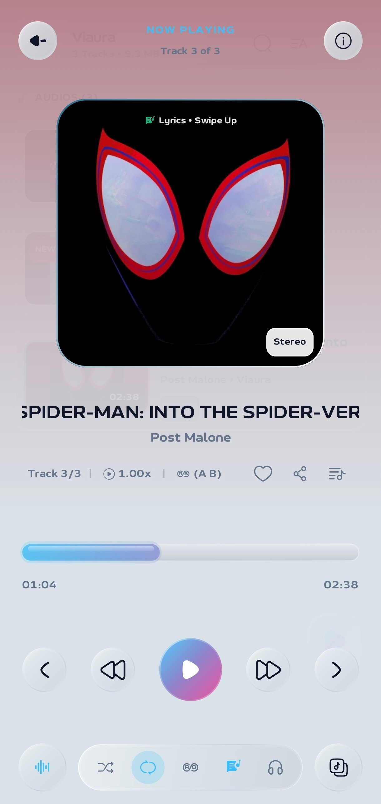
  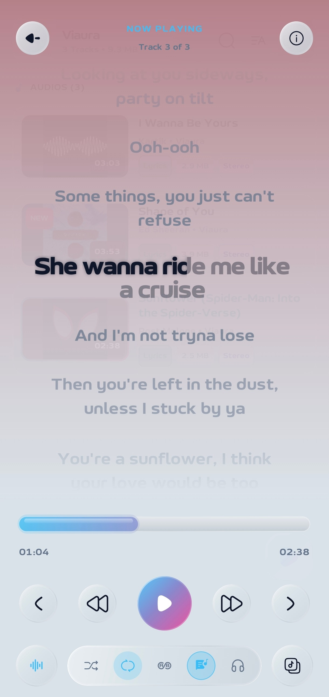

> **Left:** the *Now Playing* screen — artwork, title and artist, track counter, playback speed, A-B loop, favourite, share and queue buttons, liquid seek bar, and the control dock (shuffle, repeat, A-B, lyrics, headphone surround, equalizer, queue).
> **Right:** swipe up on the artwork to open full-screen **synced lyrics** with a per-word karaoke fill effect.

### ⚙️ Settings & About

  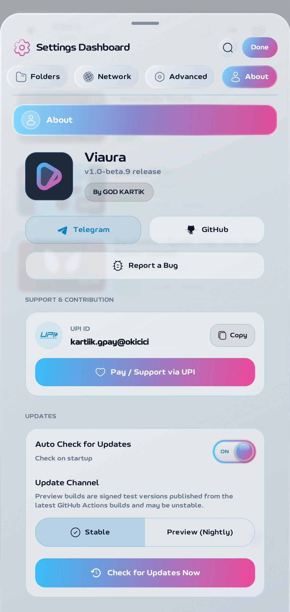

> The **Settings Dashboard** — searchable, with tabs for Appearance, Folders, Network, Advanced and About. The *About* tab shows the app version, project links, support options, the **Updates** card (Auto check, Stable / Preview channel, Check now) and a live **Device & System Specifications** report.

---

## What is Viaura?

**Viaura** is an all-in-one Android media player. It plays your local videos and music through the **mpv** engine (hardware decoding, advanced subtitles, gestures, filters), and extends that with online music & video search, lyrics, torrent downloads, network streams and an extension system for streaming providers — all wrapped in a custom **Liquid Glass** interface with its own font, gradients and animations.

It is built entirely with **Jetpack Compose** (no XML screens), distributed through **GitHub Releases** (no Play Store), and updates itself from those releases.

---

## Feature Overview

| Area | Highlights |
|---|---|
| 🎬 **Video Player** | mpv engine, hardware decoding, 0.25×–4× speed, A-B loop, frame-by-frame, zoom up to 500 %, PiP, mini player, screenshots |
| 🖐️ **Gestures** | Brightness, volume (with boost), seek, pinch-zoom, hold-to-speed, fully assignable single/double-tap zones |
| 📝 **Subtitles** | ASS/SSA, SRT, VTT, SAMI, LRC, MPL2, TTML, STL, MicroDVD · libass · dual subtitles · full style editor · AI translation |
| 🎨 **Video Filters** | 11 look presets + manual brightness / contrast / saturation / gamma / hue / temperature / tint / sharpness / deband |
| 🎵 **Music Player** | Library, 16-preset equalizer, channel modes, headphone surround, A-B loop, queue, sleep timer, background playback |
| 🎤 **Lyrics** | Local, embedded and online lyrics from 12+ providers, karaoke word-by-word fill, translation |
| 🌍 **Online** | YouTube-style music & video search, recommendations, channels, Watch later |
| 🔌 **Plugins** | CloudStream (.cs3) and Vega repositories, provider pages, in-app browser for challenges |
| 🛡️ **Network** | AntiDPI + DNS over HTTPS, M3U / direct-link streams, archive (ZIP/RAR) playback |
| ⬇️ **Downloads** | Torrent / magnet downloads with per-file picker, pause / resume / stop |
| 🔒 **Privacy** | Private Vault (PBKDF2 password + recovery question), folder block list |
| 💎 **Interface** | Liquid Glass with 15+ tunable parameters, 10 gradient app themes, AMOLED black, custom animations, 3 languages |
| 🌌 **Live Backgrounds** | 35 animated backdrops (5 brand-new), seasonal festival themes, parallax, never reacts to touch |
| 🧩 **Customization** | Drag-and-drop control layout editor, 5 seek bar styles, XML settings backup & restore |
| 🔄 **Updates** | In-app updater from GitHub Releases (Stable & Nightly channels) |

---

## Detailed Features

<b>📁 1. Library & Navigation</b>

| Feature | Description |
|---|---|
| **Folder Cards** | Every folder shows its total video count, size and detected resolution so you can see what is inside before opening it. |
| **Six-Tab Floating Dock** | Videos, Music, Recents, Playlists, Network and Downloads. Each tab can be shown or hidden from Settings, and the app remembers the tab you were on. |
| **Online Video Card** | A shortcut at the top of the library to search and stream any video online. |
| **Folder Tree Compression** | Folders that contain only one sub-folder are collapsed into a single compact node, so you reach your videos in fewer taps. |
| **Auto-Scroll to Last Played** | The list opens right where you stopped watching. |
| **"NEW" Badge** | Recently added videos get a vibrant NEW badge. You choose how many days a video counts as new. |
| **Unplayed Counter** | Folders can display how many videos inside have not been watched yet. |
| **Watched Progress Threshold** | Choose how much of a video must be played before it is marked as watched. |
| **Show Full Filename** | Optionally display complete file names with extensions instead of cleaned titles. |
| **Smart Thumbnails** | Frame previews for every video. Strategy can be *Smart* (samples the video and picks a clear representative frame) or *Embedded + Generated*. Quality levels: Low (120 px), Medium (240 px), High (480 px), Maximum (720 px). |
| **Tap-Thumbnail Multi-Select** | Tap a thumbnail to start selection mode and manage many files at once. |
| **Search & Sort** | Global search plus a sort and view dialog for ordering and switching layouts. |
| **Dual-Pane Layout** | On wide screens and tablets, folders and content can sit side by side. |
| **Recents** | A dedicated history tab for quick resume of everything you played recently. |
| **Custom Playlists** | Create your own playlists and series collections. |
| **Block List** | Hide chosen video or audio folders from the library entirely. |
| **Swipeable Tabs** | Swipe between main destinations; the dock highlight slides with you. |

<b>🎬 2. Video Playback Engine</b>

| Feature | Description |
|---|---|
| **mpv / libmpv Core** | All video is played through libmpv with FFmpeg codecs — wide format and codec support, including MKV with multiple audio and subtitle tracks. |
| **Hardware Acceleration Modes** | *Force MediaCodec* (maximum frame sync and smoothness), *Prefer (Auto Copy)* hardware decoding with copy-back fallback, or *Software CPU* decoding for troubleshooting GPU glitches. A decoder switcher is also available inside the player. |
| **libass Subtitle Renderer** | Pixel-perfect Aegisub styles, transforms and karaoke effects. |
| **Resume Where You Left Off** | Playback position is saved when you quit and restored next time. |
| **Autoplay Next & Repeat Playlist** | Continue with the next episode automatically, optionally loop the whole playlist after the last one. |
| **Close After Playback** | Automatically leave the player when the video ends. |
| **Precise Seeking** | Jump to the exact requested frame instead of the nearest keyframe. |
| **ThumbFast Seek Preview** | A quick thumbnail preview while you scrub the seek bar. |
| **Buffered Range Display** | See the cached portion of a stream directly on the seek bar. |
| **Playback Speed 0.25×–4.0×** | Presets from quarter speed to 4×, with optional **audio pitch correction** to keep voices natural. |
| **A-B Loop** | Mark a start and end point and loop that segment infinitely. |
| **Frame-by-Frame & Screenshot** | Step through frames and capture the current frame instantly. |
| **Video Zoom 50 %–500 %** | Pan and scale the picture freely. |
| **Display Modes** | Fit, Fill, Zoom-in and Full-screen aspect handling. |
| **Flip & Mirror** | Flip vertically, or mirror left/right. |
| **Orientation Control (8 modes)** | Free, Video (follows aspect ratio), Portrait, Reverse portrait, Sensor portrait, Landscape, Reverse landscape and Sensor landscape. |
| **Picture-in-Picture** | Floating pop-up window, with *Auto PiP* when you minimise the player. |
| **Video Mini Player** | Keep a small player running while you browse the library. |
| **Background / Audio-Only Mode** | Keep audio playing when the app is minimised or the screen is off. |
| **Sleep Timer** | One app-wide timer for video and audio; when it expires the player closes cleanly and the app exits. |
| **Keep Screen On When Paused** | Prevents the display from timing out during a pause. |
| **Autoplay After Unlock** | Resume automatically when the device is unlocked. |
| **Remember Brightness** | Restores the screen brightness you set for playback. |
| **Safe Area Window** | Keeps controls away from notches and curved screen edges. |
| **Lock Controls** | Lock the touch screen against accidental taps. |
| **Chapters** | Browse chapter markers and jump straight to a landmark. |
| **Playlist & Episode Queue** | Open the episode queue and playlist manager from inside the player. |
| **Copy Timestamp** | Double-tap to copy the current playback time to the clipboard. |
| **Side-by-Side Dual View** | Force a split-view layout on landscape screens. |
| **Cast Button** | Screen-cast / wireless display control inside the player. |
| **Player Action Notifications** | Sleek glass toasts when you change tracks, loop or seek. |
| **Screenshots** | Save as PNG, JPG or WebP, optionally burn subtitles into the image, set quality / compression and a custom filename template. |

<b>🖐️ 3. Gesture System</b>

| Feature | Description |
|---|---|
| **Brightness Gesture** | Swipe vertically on the left side of the screen. |
| **Volume Gesture** | Swipe vertically on the right side of the screen. |
| **Swap Sides** | Swap which side controls volume and which controls brightness. |
| **Volume Boost** | Swipe beyond 100 % up to a configurable software amplification cap. |
| **Horizontal Swipe Seek** | Swipe across the video to seek, with an on-screen target time and an adjustable sensitivity. |
| **Pinch to Zoom** | Zoom and scale the video frame with two fingers. |
| **Pinch to Zoom Subtitles** | Resize subtitle text by pinching it. |
| **Swipe Subtitles to Seek** | Swipe the subtitle area to open a dialogue-jump dialog. |
| **Hold & Drag Subtitles** | Long-press subtitle text and drag it to a new position. |
| **Hold for Speed** | Press and hold to play at a multiplied speed (configurable), with an animated speed badge. |
| **Double-Tap Zones** | Left, centre and right zones each have their own assignable action (seek back, play/pause, seek forward…). Seek duration and zone width are adjustable. |
| **Single-Tap Zones** | The same independent, assignable actions for single taps. |
| **Swipe Up for Playlist** | Swipe up from the centre of the player to open the playlist. |
| **Sensitivity Curves** | *Linear* (1:1, uniform steps) or *Exponential* (perceptual curve) response for volume and brightness. |
| **Ripple & Seek-Time Feedback** | Optional ripple animation on double-tap seek and relative seek-time display. |

<b>🧩 4. Player Layout Customizer & Seek Bar</b>

| Feature | Description |
|---|---|
| **Control Layout Editor** | Decide exactly which tools appear and where. Five zones: *Top Right*, *Bottom Left* and *Bottom Right* for landscape, plus *Portrait Top Bar* and *Portrait Bottom Bar*. |
| **Drag-and-Drop Tools** | Add tools with **+**, touch-and-hold to drag them into order, remove what you do not need. The 3-dot *More Options* menu stays fixed at the end. |
| **Available Tools** | Cast, Chapters, Decoder switcher, Audio track, Subtitle track & file browser, Seek bar style, Audio-only mode, Lock controls, Screen rotation, Playback speed, Repeat, Shuffle, A-B loop, Screenshot & frames, Video zoom, Picture-in-Picture, Display mode, Flip vertical, Mirror left / right, Filters, Pitch correction, Playlist & episodes. |
| **Visible / Hidden Per Tool** | Choose whether each tool is enabled in the player or tucked away. |
| **Play-Button Position** | Place the main playback buttons at the centre of the screen or between the seek bar and tools, separately for portrait and landscape. |
| **5 Seek Bar Styles** | *Normal* (line with circular knob), *Standard* (rounded bar with divider), *Wavy* (animated sine curve), *Thick* (bold pill) and *Slim* (flat pill, no thumb). |
| **Hide Button Backgrounds** | Show icons only, without button backdrops. |
| **Always-Dark Buttons** | Keep player buttons dark regardless of the app theme. |
| **Auto-Hide Timeout** | Set how long controls stay visible after the last touch. |
| **Top Clock & Status** | Show nothing, system, 12-hour or 24-hour clock together with the battery / network badge. |
| **System Bars With Controls** | Optionally show the status bar and navigation bar whenever controls are visible. |
| **Controls Animation Styles** | Smooth fade & slide, Cinematic Scale, Fluid Expand, Gentle Bounce, Minimal Fade or none. |

<b>📝 5. Subtitle System</b>

| Feature | Description |
|---|---|
| **Wide Format Support** | ASS/SSA, SRT, WebVTT, SAMI, LRC, MPL2, TTML/DFXP, STL and MicroDVD — everything is converted to ASS internally so mpv can render it consistently. |
| **Embedded & External Tracks** | Pick embedded tracks, load external files with the built-in subtitle file browser, or let Viaura auto-load subtitles whose name matches the video. |
| **Preferred Languages** | Order your languages by priority (for example *eng, hin, jpn*) and Viaura selects the best track automatically. Can be applied to chosen folders or videos only. |
| **Dual Subtitles** | Show a primary and a secondary subtitle at the same time. |
| **Signs & Songs Priority** | Prefer signs, songs and forced narrative tracks when available. |
| **Style Panel** | Change font, size, bold / italic / underline, alignment, text, border, shadow and background colours with opacity, border size, shadow blur / offset, background padding and corner radius, character & word spacing, vertical position and a scale factor. |
| **Override ASS/SSA** | Force your own styling over embedded ASS subtitles — or leave the original typesetting untouched. |
| **Advanced ASS Style Editor** | Edit every style of the current ASS/SSA track individually: font name and size, Primary / Secondary / Outline / Back colours, bold/italic/underline/strike-out, ScaleX / ScaleY, spacing, angle, border style, outline, shadow, alignment (1–9), margins (L/R/V) and encoding. Reset any style to the original with one tap. |
| **Raw Script Editor** | View and edit the complete subtitle text, including the `[Script Info]` block, in any format. |
| **Custom Fonts** | Import `.ttf` / `.otf` fonts or point Viaura to a fonts directory; reload, apply or remove fonts from the loaded-font library. |
| **Embedded Font Extraction** | Loads fonts packed inside MKV / MP4 containers so styled anime subtitles look exactly as authored. |
| **Multi-Script Fallback Font** | A bundled Go Noto universal font avoids "tofu" boxes for missing glyphs. |
| **Scale With Window** | Subtitles resize proportionally with the player window. |
| **Blend With Video** | Apply video colour grading and filters to subtitles as well. |
| **MKV Manager Engine** | A built-in EBML reader/writer that extracts and re-muxes subtitle tracks, chapters and attachments without transcoding. |
| **AI Subtitle Translation** | Translate the selected subtitle track with your own API key. Timing and style tags are protected while the text is translated. Supports source auto-detect, any target language, and a custom prompt (typed or loaded from a `.txt` file). |

<b>🤖 6. AI Features (Bring Your Own Key)</b>

| Feature | Description |
|---|---|
| **Multiple Providers** | Google, OpenAI, Anthropic, DeepSeek, Groq, OpenRouter, Together, OpenCode — or any **OpenAI-compatible** base URL via the *Default* option. |
| **Key Verification** | Verify your key and automatically discover the models your account can use. |
| **Auto-Select Best Model** | Picks a model that is most likely to work (free / fast / lightweight models first). |
| **Balance Check** | Query the remaining balance on supported providers. |
| **Encrypted Key Storage** | The API key is encrypted with the Android Keystore. Viaura bundles no key and runs no backend. |
| **Individual Toggles** | Enable or disable each AI feature separately. |

<b>🎨 7. Video Filters & Adjustments</b>

| Feature | Description |
|---|---|
| **11 Real-Time Presets** | Vivid, Warm Tone, Cool Tone, Soft Pastel, Cinematic, Dramatic, Night Mode, Nostalgic, Ghibli Style, Neon Pop and Deep Black (plus *None*). |
| **Manual Adjustments** | Fine-tune brightness, contrast, saturation, gamma, hue, colour temperature, tint, sharpness and an optional deband filter. |
| **Live Preview** | Filters are applied live while the video is playing. |

<b>⏭️ 8. Skip Intro / Outro</b>

| Feature | Description |
|---|---|
| **Custom Skip Duration** | Set how many seconds the skip buttons jump. |
| **Chapter-Title Detection** | Opening and ending segments are recognised from embedded chapter titles, using your own keywords (for example *OP, Opening, Intro* / *ED, Ending, Outro*). |
| **Online Skip Markers** | Optionally fetch intro / outro timestamps from online databases (IntroDB, TIDB, AniSkip). |
| **Auto-Skip** | Automatically jump past openings and move on to the next episode when an ending starts. |
| **Skip Button** | A dedicated on-screen chapter-skip button appears when a skippable segment is detected. |

<b>🎵 9. Music Library & Audio Player</b>

| Feature | Description |
|---|---|
| **Audio Library** | Browse local audio folders with artwork, metadata titles and track counts. |
| **Now Playing Screen** | Large artwork (or an animated waveform when there is no cover), title, artist, track *X of Y*, speed, and quick actions. |
| **Liquid Seek Bar** | A glass seek bar with an animated ribbon effect, plus an interactive scrubber. |
| **Shuffle & Repeat** | Shuffle, repeat-all and repeat-one. |
| **A-B Segment Loop** | Set point A and point B and loop that part of a song — great for practising or studying. |
| **Playback Speed** | Change the speed of a song straight from the player. |
| **Favourites & Share** | Heart a track to favourite it and share it with other apps. |
| **Queue Manager** | Open the up-next queue and manage it with swipe actions on each item. |
| **16-Preset Equalizer** | Flat, Rock, Pop, Jazz, Classical, Electronic, Bass Boost, Treble Boost, Voice Boost, Loudness, Cinema 3D, Deep Bass, Vocal Clarity, Acoustic, Hi-Fi Master and Night Dialog. |
| **Audio Channel Modes** | Auto, Auto Safe, Mono, Stereo, Reversed Stereo, Left only and Right only. |
| **Headphone Surround** | A spatial mode for headphones (Headphone 3D, Virtual Room, Crossfeed). |
| **Volume Normalization & Pitch Correction** | Audio settings to even out loudness and keep voices natural when speed changes. |
| **Remember Audio Track** | Your manual audio-track choice is remembered for next time. |
| **Embedded Metadata** | Reads ID3 / Vorbis / MP4 tags, cover art and embedded lyrics. |
| **Background Playback** | Foreground service with a media notification and lock-screen controls. |
| **Mini Audio Player** | Keep music controls on screen while you browse. |
| **Sleep Timer** | Moon-icon timer in the player for falling asleep to music. |
| **Playback History** | Recently played tracks are remembered. |

<b>🎤 10. Lyrics</b>

| Feature | Description |
|---|---|
| **Swipe-Up Lyrics** | Swipe up on the artwork to reveal lyrics; swipe down to return to the cover. |
| **Karaoke Rendering** | Frame-smooth highlighting with a per-word fill, a zoomed current line, centre-follow scrolling and tap-to-seek on any line. |
| **Local Lyrics** | Reads sibling `.lrc` / `.txt` files and tags embedded in the audio file; you can also import lyrics manually. |
| **Online Lyrics (12+ Providers)** | LRCLIB, Musixmatch, Genius, KuGou, YouTube, BetterLyrics, PaxSenix, LyricsPlus, SimpMusic, Unison, Megalobiz, LrcRed and BiniLyrics — queried in parallel, with per-provider caches and smart track matching. |
| **Word-Level Timing** | Supports enhanced LRC word timestamps, offsets and TTML. Plain-text lyrics use a clearly best-effort timing estimate. |
| **Lyrics Translation & Transliteration** | Translate lyrics into another language with keyless web endpoints, or transliterate on-device where Android supports it. Switch between original and translated text. |
| **Auto-Load for Neighbours** | Lyrics for the previous and next tracks in the queue are loaded ahead of time. |

<b>🌍 11. Online Music & Video</b>

| Feature | Description |
|---|---|
| **Online Music Search** | Search and stream songs online (no API key required). Includes "Did you mean…" suggestions and search-as-you-type suggestions. |
| **Recommendations** | A *Recommended for you* feed that adapts to what you play, with a **Not interested** action to see fewer songs like that. |
| **Online Video** | Search and stream video from the internet directly from the library. |
| **Channel Pages** | Banner, verified badge and tabs for Home, Videos, Shorts, Playlists and Posts. |
| **Watch Later** | Save songs and videos for later. |
| **Playlist Links** | Open an online playlist from a link. |
| **Up-Next Sequencing** | Related tracks are queued intelligently while you listen. |
| **Share-to-Viaura** | Share a link from another app to play it in Viaura, or open the quick download sheet. |

<b>🔌 12. Network, Plugins & Streaming</b>

| Feature | Description |
|---|---|
| **Local Network / Direct Links** | Play direct media URLs (MP4, MKV, M3U8, MPD). |
| **M3U Playlists** | Import and parse M3U / M3U8 playlists. |
| **Archive Playback** | Play media inside ZIP / RAR archives. |
| **Plugin Repositories** | Paste a repository link or short code in *Network → Media*. Supports **CloudStream** (`.cs3`) and **Vega** repositories, GitHub project URLs and `cloudstreamrepo://` links. |
| **Install / Update / Install All** | One-tap install and update buttons, with up to three plugins installed in parallel. |
| **Provider Pages** | Hero banner that auto-advances, *Continue watching*, *Watch later*, category rows, genres and a provider-wide search. |
| **Smart Server Failover** | If a stream fails, Viaura retries the same server, asks the provider for fresh links, and then moves to the next server — it never drops a server just because it is buffering. |
| **Adaptive HLS Quality** | *Auto* quality steps down after repeated stalls and starts from a measured connection speed. |
| **In-App Browser Challenges** | When a site shows a Cloudflare / DDoS-Guard check or a login wall, the page opens inside Viaura and the request is retried with the resulting session. |
| **Manga / Comic Reader** | Vertical-scroll reader with page prefetch, tap-to-retry and tall-strip slicing. |
| **AntiDPI** | Bypass ISP blocking **without a VPN** using a local bypass proxy (TLS + TCP split method). |
| **DNS over HTTPS** | Site names are resolved through a secure DNS instead of the ISP's. |
| **Network Monitor** | Reloads a stalled video only when the real network actually changes. |

<b>⬇️ 13. Downloads (Torrents)</b>

| Feature | Description |
|---|---|
| **Magnet / Torrent Support** | Open a magnet link, info hash or `.torrent` file from the Network tab or from another app. |
| **File Picker** | See every file inside a torrent and download only what you want. |
| **Download Manager** | Pause, resume, stop, cancel and remove transfers; interrupted downloads resume. |
| **Foreground Service** | Downloads keep running in the background with a notification. |
| **Download-Only Design** | Torrents are downloaded, not streamed — a faster and simpler engine. |

<b>🔒 14. Privacy & Security</b>

| Feature | Description |
|---|---|
| **Private Vault** | Move whole video or audio folders into a protected vault. The password is hashed with **PBKDF2**, with a security question for recovery. |
| **Restore From Vault** | Move a folder back to public storage at any time. |
| **Folder Block List** | Hide folders from Viaura without moving any files. |
| **Encrypted API Key** | AI provider keys are stored encrypted with the Android Keystore. |
| **No Analytics, No Backend** | The app contains no analytics, tracking or server of its own. |

<b>💎 15. Appearance & Liquid Glass</b>

| Feature | Description |
|---|---|
| **Liquid Glass UI** | Frosted-glass panels with a customisable look: opacity, blur, tint, refraction height and amount, depth effect, chromatic aberration, vibrancy, saturation, brightness, contrast and glowing border highlight (style, strength, width, blur). One-tap reset. |
| **Glass Sliders & Switches** | Every slider and switch in the app can use the glass look, including the ON / OFF switch in the Liquid Glass live preview. |
| **Light, Dark & System** | Follow the system or force a mode. |
| **AMOLED Black** | Pure `#000000` backgrounds to save power on OLED screens. |
| **System Tone** | Surfaces tinted from your wallpaper hue (Android 12+) or from a colour you pick. |
| **Sky-Blue → Pink Gradient** | A signature accent gradient used across buttons, progress and indicators. |
| **10 Gradient App Themes** | Pick the app theme from slim phone-style previews: your own editable gradient (double-tap to edit its colours) plus 9 ready-made ones — Sky-Violet-Pink, Sunset, Aurora, Candy, Fire, Ocean, Forest, Orchid, Lava and Lagoon. |
| **Live Background Animations** | 35 animated backdrops behind the library screens: Circles, Rings, Space, Shapes, Snow, Grid, Particles, Lava lamp, Aurora, Fireflies, Rain, Bokeh, Sakura, Constellation, Bubbles, Waves, Meteors, Embers, Hexagons, Clouds, Leaves, Galaxy, Radar, Equalizer, Orbits, Warp, Flow, Prism, Lanterns, Confetti and the all-new **Silk, Nebula, Ripples, Synthwave and Mandala** (own *NEW* section). They only react to tilt (optional parallax), never to touch, and follow your theme colours. |
| **Random Background** | Let Viaura pick one for you on every launch, daily, or every 3 days. |
| **Seasonal Themes** | Festive backdrops automatically during Diwali, Holi, Halloween, New Year and winter holidays (can be turned off). |
| **Custom Typeface** | The bundled Viaura display font, or switch to the system font. |
| **Display Zoom** | Scale the whole interface up or down. |
| **Transition Styles** | Player enter: Fade from Black, Zoom Burst (grows from the tapped thumbnail), Slide Up, Cinema Bars. Screens: Elastic Slide, Depth Zoom, Flip Fade and more. Tabs: sliding underline, spring pill, scale pulse, cross-fade or none. |
| **Global Motion Scale** | Speed all animations from 0.25× to 2×, or reduce motion for performance. |
| **Haptic Feedback** | Subtle vibration on key actions. |
| **3 Interface Languages** | English, Hinglish and Hindi (हिन्दी, Devanagari). |
| **Splash & Icons** | Animated launch splash and themed adaptive launcher icon. |

<b>⚙️ 16. Settings, Backup & Updates</b>

| Feature | Description |
|---|---|
| **Settings Dashboard** | Tabs for Appearance, Player, Audio, Decoder, Subtitles, Folders, Network, Advanced and About, with a **search box** that finds any setting by name or description. |
| **Export / Import Settings** | Back up all your settings to an XML file and restore them on any device. |
| **In-App Updater** | Checks GitHub Releases on startup, shows release notes, downloads the APK, verifies its signature / package and installs it. Choose the **Stable** or **Nightly** channel — Nightly always offers the newest Actions build. |
| **Device & System Report** | Shows your device model, Android version, SoC, architecture, RAM, display capabilities (refresh rate, HDR, colour gamut), audio hardware and the bundled engine versions. |
| **Support Page** | Project links and a UPI support option (`kartiik.gpay@okicici`) with copy and one-tap pay. |

---

## Installation

1. Open the **[Releases](https://github.com/karrtik-xe/Viaura/releases)** page.
2. Download the APK for your device:
   - **`arm64-v8a`** — recommended for almost all modern phones
   - **`armeabi-v7a`** — older 32-bit phones
   - **`x86` / `x86_64`** — emulators and some tablets
   - **`universal`** — works everywhere (larger file)
3. Open the downloaded file and allow *Install unknown apps* for your browser or file manager when Android asks.
4. Launch **Viaura** and grant storage / media access so it can find your videos and music.

**Requirements:** Android 8.0 (API 26) or newer.

> Every release is signed with the same key, so updates install over the previous version without losing your data.

## Updating

Open **Settings → About → Updates**. Viaura checks GitHub Releases automatically at startup (you can turn this off) and offers an *Update Available* sheet with the release notes.

- **Stable** — tested releases, for example `Viaura-v1.1_arm64-v8a.apk`.
- **Preview (Nightly)** — the newest build from every push, for example `Viaura-v1.1beta6_arm64-v8a.apk`. The number after `beta` is the GitHub Actions run number and the same number the app shows as its build.
  

## Tech Stack & Credits

- **Kotlin** · **Jetpack Compose** · Material 3 (100 % Compose UI)
- **mpv-android-lib** (libmpv + FFmpeg + libass) — playback engine
- **NewPipeExtractor** — online music & video search
- **libtorrent4j** — torrent downloads
- **CloudStream runtime** (GPL-3.0) — `.cs3` plugin support
- **yt-dlp** and **QuickJS-NG** — optional online-video runtime
- **Go Noto Universal** — multi-script subtitle fallback font
- **LRCLIB** and the other lyric providers listed above
- Inspired by the open-source **mpvRx** project

Viaura was created with **Google AI Studio**'s Android build feature and refined on a phone. Thanks to every open-source maintainer whose work makes this possible.

## Disclaimer

Viaura is a **media player**. It does **not** host, upload, distribute or ship any copyrighted content, streaming provider or plugin repository. Plugins and repositories are third-party software that **you** choose to add, and you are solely responsible for what you play, download or stream with them and for following the laws and terms of service in your country. Screenshots in this README are shown only to illustrate the user interface.

## Support the Project

If Viaura is useful to you:

- ⭐ **Star** this repository
- 🐞 Report bugs and suggest features in **[Issues](https://github.com/karrtik-xe/Viaura/issues)**
- 💬 Join the **Telegram** community
- ❤️ Support development via **UPI**: `kartiik.gpay@okicici` (also under *Settings → About*)

<b>Made with ❤️ by GOD KARTiK</b>

